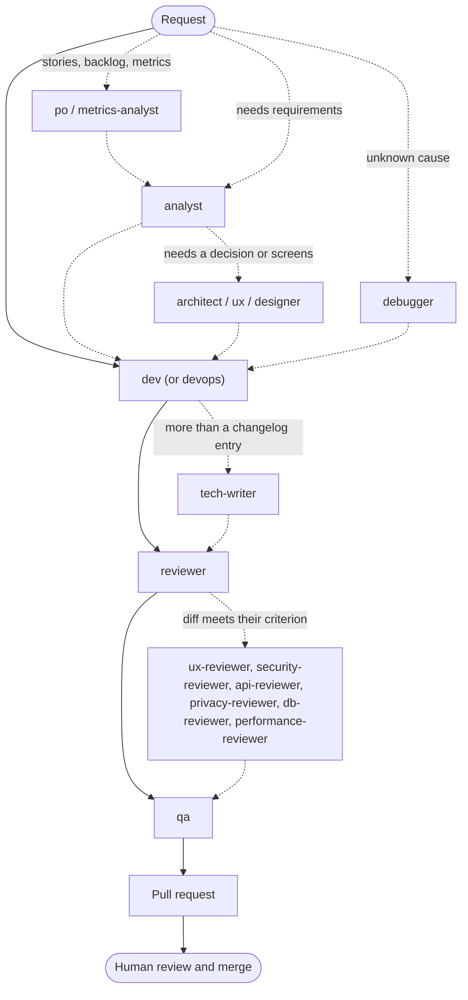
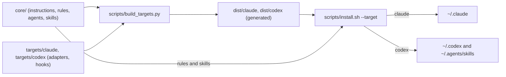

# ifdev-agent-team

An agent team (process, rules, roles and skills) for coding agents: Claude Code and OpenAI Codex.

One reviewed, versioned set of **global** defaults: a delivery process (Analyze → Plan → Implement → Test → Review → Document), engineering, testing and Git rules, eighteen senior roles from product owner to QA, and general-purpose and stack skills. The installer links them into your home directory, so every machine and every tool uses the same content. Each project keeps its own instructions on top.

🧩 process · 📏 rules · 👥 roles · 🧰 skills · 🔔 notifications · 🔒 safe, idempotent install

## ✨ What you get

- 🧭 **A team process**: who runs when, from requirements to a pull request a human merges ([`core/instructions.md`](core/instructions.md)).
- 📏 **Three rules**, defined once: [engineering principles](core/rules/engineering-principles.md), [testing](core/rules/testing.md) and the [Git workflow](core/rules/git-workflow.md).
- 👥 **Eighteen roles**, each started in a fresh context, read-only where it should be ([`core/agents/`](core/agents/)).
- 🧰 **Eight skills**: local verification, work sessions, safe refactoring, end-to-end tests and stack guidance.
- 🔔 **Notifications** when an agent finishes, is blocked or needs you.
- 🔒 **A safe installer**: symlinks instead of copies (except the Codex custom agents, which Codex only loads as regular files), backups instead of deletion, a dry run, no elevated privileges.

## 🧭 How the team works

The main agent orchestrates: it takes blocking questions to you, fixes findings and delivers. Dashed arrows lead to roles that run only when their criterion applies.



Documentation-only or trivial changes stop at the Reviewer. The full criteria are in [`core/instructions.md`](core/instructions.md#team-analyst--dev--reviewer--qa); [docs/team.md](docs/team.md) explains every role.

## 👥 Roles

✍️ writes files · 👁️ read-only

| | Role | What it does | Access |
|---|---|---|---|
| 🎯 | [`po`](core/agents/po.md) | Epics, user stories, prioritized backlog, release cut | ✍️ product files only |
| 📊 | [`metrics-analyst`](core/agents/metrics-analyst.md) | Success metrics, tracking plans, experiments | ✍️ analytics documents only |
| 🔍 | [`analyst`](core/agents/analyst.md) | Requirements with numbered, testable acceptance criteria | 👁️ |
| 🏛️ | [`architect`](core/agents/architect.md) | Options, decision record draft, contracts, slicing | 👁️ |
| 🧭 | [`ux`](core/agents/ux.md) | Flows, screen states, copy, prototypes | ✍️ design files only |
| 🎨 | [`designer`](core/agents/designer.md) | Logos, visual identity, brand assets | ✍️ design files only |
| 🐞 | [`debugger`](core/agents/debugger.md) | Reproduces a bug and finds the root cause | 👁️ |
| 💻 | [`dev`](core/agents/dev.md) | Implements the change with its tests | ✍️ |
| ⚙️ | [`devops`](core/agents/devops.md) | CI/CD, infrastructure, observability; verifies locally only | ✍️ |
| 📝 | [`tech-writer`](core/agents/tech-writer.md) | Guides, references, runbooks, release notes | ✍️ documentation only |
| ✅ | [`reviewer`](core/agents/reviewer.md) | Independent review of every diff | 👁️ |
| 🖥️ | [`ux-reviewer`](core/agents/ux-reviewer.md) | Interface states, accessibility, copy | 👁️ |
| 🛡️ | [`security-reviewer`](core/agents/security-reviewer.md) | Auth, data access, secrets, dependencies | 👁️ |
| 🔌 | [`api-reviewer`](core/agents/api-reviewer.md) | Published contracts and external integrations | 👁️ |
| 🔐 | [`privacy-reviewer`](core/agents/privacy-reviewer.md) | Personal data, consent, retention | 👁️ |
| 🗄️ | [`db-reviewer`](core/agents/db-reviewer.md) | Schema, migrations, queries, access policies | 👁️ |
| ⚡ | [`performance-reviewer`](core/agents/performance-reviewer.md) | Hot paths, payloads, caching, cost | 👁️ |
| 🧪 | [`qa`](core/agents/qa.md) | Verifies against the criteria, writes acceptance tests | ✍️ test files only |

No role commits, pushes or deploys; delivery belongs to the main agent and follows the [Git workflow](core/rules/git-workflow.md).

## 🧰 Skills

| Skill | Use |
|---|---|
| [`verify-changes`](core/skills/verify-changes/SKILL.md) | Pick and run the local checks for the current change |
| [`work-session`](core/skills/work-session/SKILL.md) | A bounded work session with a plan and a resume report |
| [`safe-refactor`](core/skills/safe-refactor/SKILL.md) | Refactor without changing behavior |
| [`e2e-testing`](core/skills/e2e-testing/SKILL.md) | Acceptance and end-to-end tests from acceptance criteria |
| [`web-dev`](core/skills/web-dev/SKILL.md), [`flutter-dev`](core/skills/flutter-dev/SKILL.md), [`supabase-dev`](core/skills/supabase-dev/SKILL.md), [`java-spring-dev`](core/skills/java-spring-dev/SKILL.md) | Stack guidance, read only when a change touches that stack |

## 🔌 Supported tools

| | Claude Code (`--target claude`) | OpenAI Codex (`--target codex`) |
|---|---|---|
| Roles run as | ✅ subagents of the same name | ✅ custom agents started with `spawn_agent` and `fork_turns: "none"` |
| Read-only roles | ✅ enforced (edit tools blocked) | ⚠️ by instruction only; any edit is reported |
| Skills | ✅ `~/.claude/skills/` | ✅ `~/.agents/skills/` |
| Notifications | ✅ `Stop`, `StopFailure` and `Notification` hooks | ⚠️ opt-in `notify` adapter, turn completion only; you add one line to `config.toml`, the installer never edits it |
| Status | ✅ supported | ⚠️ supported; custom agent registration still needs a manual check in a Codex session |

Details: [docs/installation.md](docs/installation.md#targets) and [docs/notifications.md](docs/notifications.md).

## 🏗️ How it's built

Content is written once, tool-neutral, in `core/`. A generator combines it with each tool's adapter in `targets/<tool>/` into `dist/<tool>/`, which is committed and never edited by hand. The installer links the result into your home directory.



Layout, generator, validator and tests: [docs/development.md](docs/development.md).

## 🚀 Quick start

Needs Bash, `git` and `python3` (standard library only). The coding tools themselves are installed separately.

```bash
git clone https://github.com/ifdevtecnologia/ifdev-agent-team.git
cd ifdev-agent-team
./scripts/install.sh --target claude --dry-run   # review the plan; changes nothing
./scripts/install.sh --target claude             # or --target codex, or --target all
```

- **Update:** `git pull && ./scripts/install.sh` (a bare run reinstalls the recorded targets and is idempotent).
- **Uninstall:** `./scripts/uninstall.sh --dry-run`, then `./scripts/uninstall.sh` (or `--target codex` for one target).
- **Backups:** anything the installer replaces is moved to `~/.ifdev-ai-tools/backups/`, never deleted; see [manual restoration](docs/installation.md#backups-and-manual-restoration).

Keep the checkout where it is: the links point into it. The Codex custom agents in `~/.codex/agents/` are copies, so after a `git pull` only rerunning `./scripts/install.sh` brings agent changes to Codex. Everything the installer guarantees, upgrade notes and troubleshooting are in [docs/installation.md](docs/installation.md).

## 📚 More

| Document | For |
|---|---|
| [docs/installation.md](docs/installation.md) | Install, upgrade, uninstall, backups, what the toolkit owns |
| [docs/team.md](docs/team.md) | Every role, when it runs and what it never does |
| [docs/notifications.md](docs/notifications.md) | Desktop, sound and bell notifications for Claude Code and Codex |
| [docs/customization.md](docs/customization.md) | Adapting a project: `AGENTS.md`, overrides, project reviewers |
| [docs/development.md](docs/development.md) | Working on this repository: layout, validator, context budget |
| [CONTRIBUTING.md](CONTRIBUTING.md) | Contribution rules |
| [CHANGELOG.md](CHANGELOG.md) | Changes and upgrade notes |
| [docs/decisions/](docs/decisions/) | Decision records |

## License

Licensed under the [Apache License 2.0](LICENSE).
